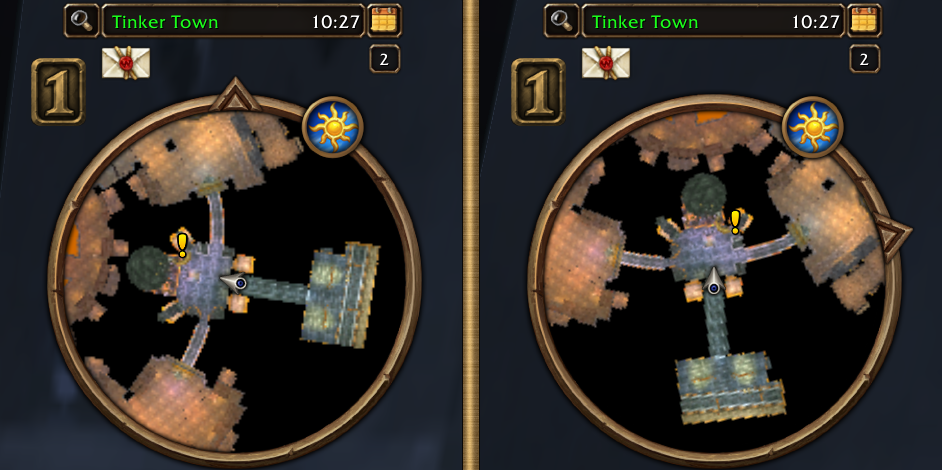

# Rotate Minimap (Forever)

This addon makes the minimap turn with your facing, instead of keeping north at the top. It is for WoW Forever (client 1.60.1) only.

Other WoW versions have a "Rotate Minimap" checkbox. Forever has no checkbox. You can turn rotation on with `/console rotateMinimap 1`, but the client turns it off again at your next login. This addon turns it back on every time, so you don't have to.

The addon has no options and saves no data.

## Before and after

Both pictures show the same place, with the player facing west. The left picture is without the addon, and the right picture is with it.

- Without the addon, the map stays fixed with north at the top, and the player arrow turns. The small triangle on the rim marks north.
- With the addon, the player arrow always points up, and the map turns around it. Here the north marker is on the right, because the player faces west.

## Why Forever needs this addon

A rotating minimap matches what you see. The top of the map is the way you face, so a quest marker on the left of the map is on your left. You don't have to turn the map in your head to find your way.

The game has a setting for this, named `rotateMinimap`, but Forever doesn't keep it.

- Other WoW versions have a "Rotate Minimap" checkbox in their interface options. Forever has the setting, but no checkbox.
- You can turn the setting on with `/console rotateMinimap 1`. But the Forever client sets it back to 0 at every login, character switch and `/reload`. Loading screens don't change it.
- No other addon, and no OneForAll option, sets it again.

The addon sets the setting to 1 at login, and again when the client resets it. The reset comes a moment after login, so the addon watches for changes for 10 seconds. After that, it leaves the setting alone.

We don't know whether the reset is a bug or a choice that Blizzard made for Forever.

## Install

1. Download the zip from the newest [release](https://github.com/WuphonsReach/wow-forever-addons-RotateMinimap/releases).
2. Unzip it into `_forever_/Interface/AddOns/`. The zip holds a `RotateMinimap` folder, and that folder must be directly in `AddOns/`.
3. Close the game and start it again. The game finds a new addon folder only after a full restart, not after `/reload`.
4. At character select, open the AddOn List and make sure that Rotate Minimap (Forever) is in the list and on.

To update, close the game, delete the old `RotateMinimap` folder, and do steps 1 to 3 again.

You can also install from the repo. Make a folder named `RotateMinimap` in `AddOns/`, and copy `RotateMinimap.toc`, `RotateMinimap.lua` and `icon.tga` into it. To change the addon and test it, see [docs/development.md](docs/development.md).

## Uninstall

1. Close the game.
2. Delete the folder `_forever_/Interface/AddOns/RotateMinimap`.
3. Start the game. After login, the minimap is north-up again.

The addon saves no data, so there is nothing else to remove. To keep the files but stop the addon, turn it off in the AddOn List at character select.

## Turn the rotation off

- For the rest of the session, type `/console rotateMinimap 0`. The addon leaves your change alone until the next login or `/reload`.
- For good, turn the addon off in the AddOn List, or uninstall it.

## When the addon is no longer necessary

The addon is no longer necessary if a Forever update does one of these things:

- **It keeps the setting.** Then `/console rotateMinimap 1` lasts after you log out. The addon does no harm, but you can uninstall it.
- **It adds a Rotate Minimap checkbox.** Then use the checkbox, and uninstall the addon. While the addon is installed, it turns rotation on at each login, even if the checkbox is clear.

To find out whether the client keeps the setting now:

1. Turn the addon off in the AddOn List.
2. Log in and type `/console rotateMinimap 1`.
3. Log out to character select, and log in again.
4. If the minimap still rotates, the client keeps the setting, and you don't need the addon.

When the addon is no longer necessary, this README and the release notes will say so.

## License

MIT. See [LICENSE](LICENSE).
